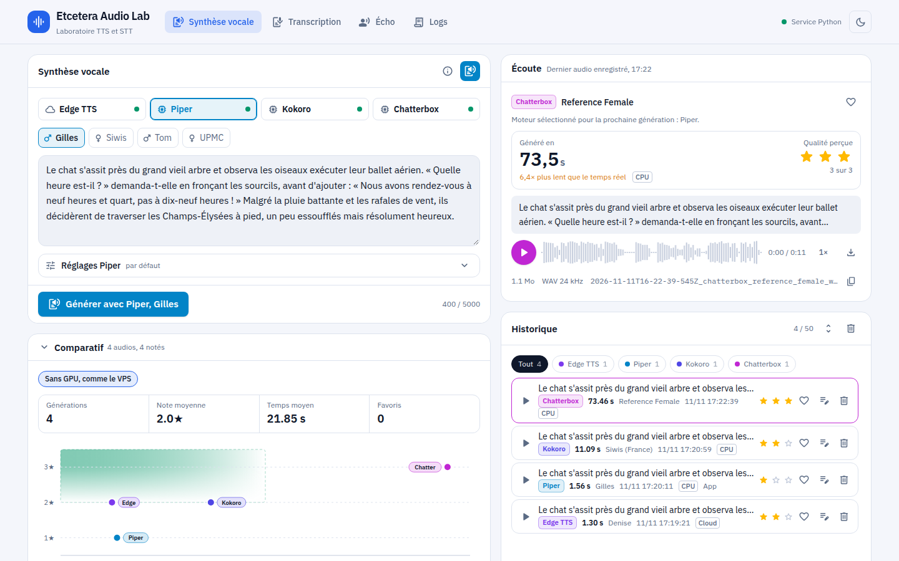
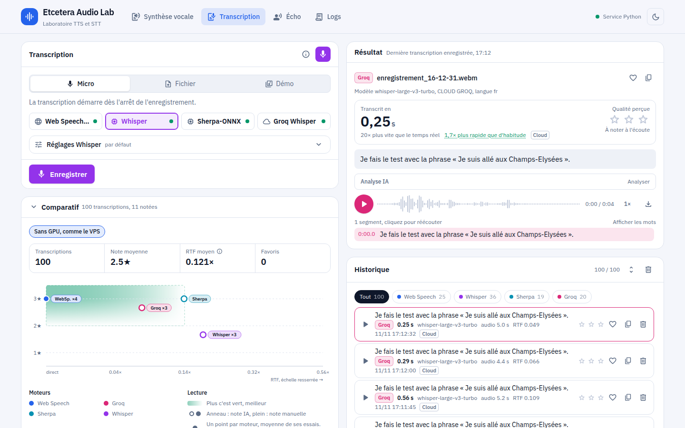
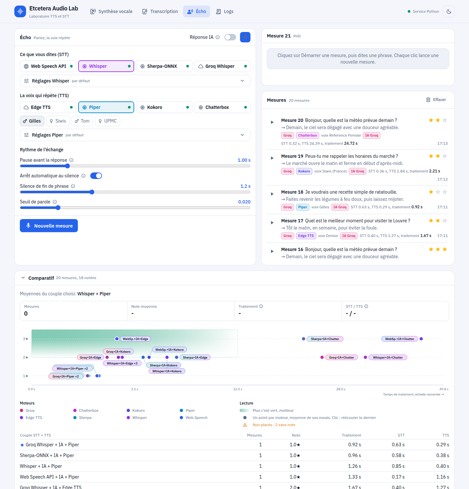

# Etcetera Audio Lab

Banc d'essai open source pour comparer, sur votre propre machine, des moteurs de synthèse vocale (TTS) et de reconnaissance vocale (STT) en français: locaux, cloud ou intégrés au navigateur, dans une même interface web.

## Pourquoi ce projet

Choisir une voix ou un moteur de transcription pour une application web se fait souvent sur la foi d'une démo en ligne. Les vraies questions arrivent ensuite: la voix française est-elle correcte sur un texte réel, combien de temps attend l'utilisateur, faut-il un GPU, que coûte l'API, que se passe-t-il quand le service tombe?

Etcetera Audio Lab répond à ces questions par la mesure. Vous envoyez le même texte ou le même enregistrement à plusieurs moteurs, vous écoutez ou lisez le résultat, vous le notez, et l'application garde pour chaque essai le temps de traitement, le moteur réellement utilisé et le détail des logs. Une matrice de décision croise ensuite qualité et rapidité pour vous aider à choisir.

Les moteurs locaux tournent côté serveur (Node.js d'abord, Python ou binaire natif en secours) et non en WASM dans le navigateur: les mesures restent représentatives d'un déploiement sur un serveur.

## Aperçu

### Synthèse vocale

Quatre moteurs, réglages propres à chacun, écoute avec spectre audio, historique noté et matrice de décision.



### Transcription

Micro, fichier ou échantillon de démo, avec le temps de traitement et le facteur temps réel de chaque essai.



### Écho

Chaque mesure chronomètre la transcription et la synthèse, puis la note place le couple STT + TTS sur la matrice de décision.



## Fonctionnalités

- Page Synthèse (`/tts`): choix du moteur et de la voix, réglages propres à chaque moteur, écoute avec spectre audio, historique filtrable avec favoris et notes.
- Page Transcription (`/stt`): enregistrement au micro, fichier audio ou échantillon de démo, texte horodaté par segment ou par mot selon le moteur, historique noté.
- Page Écho (`/echo`): vous parlez, votre phrase est transcrite puis relue par la voix choisie après une pause réglable. En mode Réponse IA, Groq vous répond à la place de l'écho: il garde le fil de la conversation et connaît les moteurs et les temps mesurés, ce qui permet de l'interroger sur la qualité des échanges. Chaque clic lance une mesure: la page chronomètre la transcription, la synthèse, la latence perçue et le temps total, puis vous notez la réponse pour placer le couple STT + TTS sur la matrice de décision.
- Page Logs (`/logs`): événements Node, Python et navigateur en temps réel, filtrables par source, niveau, texte ou identifiant de requête, avec export JSON.
- Panneau Activité sur chaque page, qui suit en direct la requête en cours.
- Bascule automatique vers un moteur de secours en cas de panne, signalée dans le résultat et l'historique.
- Thèmes clair et sombre.

## Stack

- [Next.js](https://nextjs.org/) 16 (App Router), React 19, TypeScript, Tailwind CSS v4.
- [sherpa-onnx-node](https://github.com/k2-fsa/sherpa-onnx) et [ONNX Runtime](https://onnxruntime.ai/) pour exécuter Piper, Whisper et Parakeet directement dans Node.js.
- Micro-service Python facultatif ([FastAPI](https://fastapi.tiangolo.com/), PyTorch) pour Chatterbox, Faster-Whisper sur GPU et les secours Python.
- `ffmpeg` pour décoder l'audio à transcrire, espeak-ng pour la phonémisation des voix Piper.

## Moteurs comparés

### Synthèse vocale (TTS)

| Moteur | Exécution | Licence | Version utilisée | Dernière version | Particularités |
| ------ | --------- | ------- | ---------------- | ---------------- | -------------- |
| Edge TTS (`msedge-tts`) | API distante non officielle | MIT (lib) | 2.1.1 |  | Voix Microsoft Edge Neural, sans clé API |
| Piper | Local, Node.js (`sherpa-onnx-node`), binaire natif en secours | MIT (binaire archivé), Apache 2.0 (sherpa-onnx), licence propre à chaque voix | sherpa-onnx-node 2.0.1, binaire 2023.11.14-2 |  | Voix ONNX légères (Siwis, UPMC, Tom, Gilles), CPU |
| Kokoro 82M (`kokoro-js`) | Local, Node.js et ONNX Runtime | Apache 2.0 | kokoro-js 1.2.1 |  | Meilleure qualité que Piper, voix française `ff_siwis` |
| Chatterbox (Resemble AI) | Local, micro-service Python | MIT | chatterbox-tts 0.1.7, torch 2.6.0 |  | Clonage vocal à partir d'un court échantillon, réglage de l'émotion, GPU CUDA recommandé |

### Reconnaissance vocale (STT)

| Moteur | Exécution | Licence | Version utilisée | Dernière version | Particularités |
| ------ | --------- | ------- | ---------------- | ---------------- | -------------- |
| Whisper | CPU: Node.js (`sherpa-onnx-node`), Python en secours; GPU: Faster-Whisper (Python) | MIT | sherpa-onnx-node 2.0.1, faster-whisper 1.2.1 |  | Modèles tiny à medium, horodatage mot à mot sur GPU |
| Parakeet TDT 0.6B v3 (Sherpa-ONNX) | Local, Node.js, CPU | Apache 2.0 (sherpa-onnx), CC-BY 4.0 (modèle NVIDIA) | sherpa-onnx-node 2.0.1 |  | 25 langues européennes détectées automatiquement |
| Groq Whisper | API cloud compatible OpenAI | Service commercial | `whisper-large-v3-turbo`, `whisper-large-v3` | Sans objet | Très rapide, horodatage mot à mot, clé API gratuite avec quotas journaliers |
| Web Speech API | Navigateur (Chrome, Edge) | Sans objet | Selon le navigateur | Sans objet | Transcription en direct depuis le micro, sans serveur |

## Démarrage rapide

### Prérequis

- Linux x86_64 ou Windows avec WSL2 (le binaire Piper et espeak-ng téléchargés sont des builds Linux x86_64).
- Node.js 20.9 ou plus récent, `ffmpeg`, `curl`, `tar` et `bzip2`.
- Environ 5,5 Go d'espace disque pour l'installation de base, jusqu'à 16 Go avec toutes les options (détail ci-dessous).
- Facultatif: [uv](https://docs.astral.sh/uv/) pour le service Python, et une carte NVIDIA avec CUDA pour Chatterbox et Whisper sur GPU.

### Espace disque

Le dépôt lui-même pèse moins de 10 Mo: l'essentiel vient des dépendances et des modèles téléchargés à l'installation. Les valeurs ci-dessous sont des ordres de grandeur mesurés sur une installation Linux complète.

| Élément | Emplacement | Taille approximative | Installé par |
| ------- | ----------- | -------------------- | ------------ |
| Dépendances npm (Kokoro compris) | `node_modules/` | 1,9 Go | `npm run setup` |
| Modèles sherpa-onnx (Whisper tiny à small, Parakeet, voix Piper) | `models/sherpa/` | 3 Go | `npm run setup` |
| Voix Piper et binaire de secours | `voices/`, `bin/` | 0,4 Go | `npm run setup` |
| Whisper medium (option) | `models/sherpa/` | 1,8 Go | `npm run setup:sherpa -- --whisper-medium` |
| Environnement Python (PyTorch avec CUDA) | `python/.venv/` | 6,3 Go | `npm run setup:chatterbox` |
| Poids Chatterbox et Faster-Whisper | `~/.cache/huggingface/` (hors projet) | 2 à 4 Go | Premier usage de Chatterbox et Whisper sur GPU |
| Build de production | `.next/` | 0,4 Go | `npm run build` |
| Audios générés, historiques et logs | `output/` | Quelques dizaines de Mo, croît à l'usage | Utilisation |

En résumé, comptez environ 5,5 Go sans le service Python, 7 Go avec Whisper medium, et 14 à 16 Go pour l'installation complète avec Chatterbox.

### Installation

Clonez le dépôt puis installez les dépendances, le binaire Piper, les voix et les modèles:

```bash
npm run setup
```

Pour Chatterbox, Whisper sur GPU et les secours Python, installez aussi l'environnement Python 3.12:

```bash
npm run setup:chatterbox
```

Pour utiliser Groq, copiez `.env.example` en `.env.local` et renseignez `GROQ_API_KEY` ([clé gratuite](https://console.groq.com/keys)).

### Lancement

Lancez l'application sur `http://localhost:3000`, avec le service Python s'il est installé:

```bash
npm run dev
```

Sans le service Python, seuls Chatterbox et Whisper sur GPU sont indisponibles. Le détail de l'installation, la vérification et le dépannage sont dans [AGENTS.md](AGENTS.md).

## Ajouter une voix Piper

1. Choisissez une voix sur [huggingface.co/rhasspy/piper-voices](https://huggingface.co/rhasspy/piper-voices).
2. Téléchargez ses fichiers `.onnx` et `.onnx.json` dans `voices/` (utilisés par le binaire de secours).
3. Téléchargez l'archive `vits-piper-<voix>` correspondante dans les [modèles TTS sherpa-onnx](https://github.com/k2-fsa/sherpa-onnx/releases/tag/tts-models) et extrayez-la dans `models/sherpa/`.
4. Rechargez la page: la voix apparaît dans le sélecteur.

## Avertissements

- Edge TTS passe par un endpoint de Microsoft non documenté, qui peut changer ou être coupé sans préavis. Son usage commercial n'est pas encadré par une licence.
- Les modèles téléchargés par les scripts gardent leur propre licence (voix Piper, Kokoro, Parakeet en CC-BY 4.0, Whisper): vérifiez-la avant tout usage au-delà du test.
- Le clonage vocal de Chatterbox ne doit servir qu'avec des voix dont vous avez le droit d'usage. Les échantillons fournis dans `python/tts/references/` et `public/samples/` sont des voix de synthèse.
- Groq reçoit l'audio que vous lui envoyez, ainsi que le texte des conversations en mode Réponse IA: n'y faites pas passer de données confidentielles.

## Licence

Code publié sous licence [MIT](LICENSE). Les moteurs, bibliothèques et modèles cités restent soumis à leurs licences respectives.
